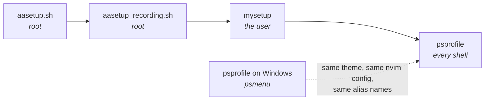

# aasetup · mysetup · psprofile

> One account, three tools, two operating systems. This is how they fit together
> and which of them owns what.

---

## At a glance

| Tool | Run by | Privilege | When | Owns |
|---|---|---|---|---|
| **`aasetup.sh`** / `aasetup_all.sh` | admin | **root** | once, at creation | the account: uid/gid, password, sudoers, first key |
| **`aasetup_recording.sh`** | admin | **root** | after creation | asciinema + atuin, locked offline by AppArmor |
| **`mysetup`** | the account holder | **none** (sudo only for packages) | any time, repeatedly | that account's own environment |
| **`psprofile`** | the account holder | none | every interactive shell | aliases, venv helpers, the prompt |

The split is deliberate: **root creates, the user configures.** `mysetup` refuses
to run as root, and `aasetup.sh` never asks the user a question.



---

## 1 · `aasetup` — making the account exist

Runs as root on Debian ≥ 12 or Ubuntu ≥ 24.04.

```bash
sudo bash aasetup.sh -u alice -e alice@example.com -n "Alice Example"

cp template-users.json users.json     # then edit it
sudo bash aasetup_all.sh              # every enabled user
```

Each account gets a uid/gid, optional passwordless sudo, a random 10-digit
password expired at first login, a generated git-identity keypair, and the
starting dotfiles. Credentials land in `/root/account-exports/<user>/` — hand
them over, then delete them.

`users.json` is **gitignored**; `template-users.json` is tracked. That is the
house rule for the whole repo: real names, keys and hosts stay out of git.

Existing accounts are skipped unless the roster says `on_exists: "setup"`.
Session recording is a separate step — see the README for the AppArmor lockdown
that keeps shell history and recordings on the machine.

---

## 2 · `mysetup` — configuring your own account

Plain Python 3 standard library. No venv, no pip, nothing to install.

```bash
./mysetup                    # interactive menu, loops until you quit
./mysetup --list             # tasks and whether each is already done
./mysetup --do gitconfig,vim # just these
./mysetup --all --dry-run    # every change a full run would make
```

The menu **loops**: setting an account up takes several passes, so after each one
you land back on the list with statuses recomputed — what you just ran now reads
`done`.

| | Task | Does |
|---|---|---|
| 1 | `sudoers` | renders the sudo rule, validates it with `visudo`, prints the install command for an admin |
| 2 | `tools` | system packages via sudo, **one `apt-get` per package** |
| 3 | `filetransfer` | trzsz and/or lrzsz — see [the Windows side](#4--the-windows-side) |
| 4 | `gitconfig` | `~/.gitconfig` from your identity |
| 5 | `nvim` | clones the house Neovim config (network) |
| 6 | `vim` | minimal `~/.vimrc` — no plugins, no network |
| 7 | `tmux` | `~/.tmux.conf` + plugin manager and plugins |
| 8 | `sshkey` | create, upload or paste this account's keypair |
| 9 | `sshconfig` | `~/.ssh/config` for the site's hosts |
| 10 | `authkeys` | paste public keys into `~/.ssh/authorized_keys` |
| 11 | `history` | preloads `~/.bash_history` so CTRL-r knows the house commands |
| 12 | `shell` | `~/.psprofile.sh` + Oh My Posh with `slimfat2` |
| 13 | `chezmoi` | installs chezmoi; does **not** init a repo |

### Everything site-specific lives in `mysetup-etc/`

The script contains no names, addresses, repo URLs or package names — point it at
a different `mysetup-etc/` and it provisions a different site.

```
mysetup-etc/
  mysetup.conf      [vars] site values · [ask] questions · [task:*] the menu
  conf.d/*.conf     drop-in overrides, read after mysetup.conf
  packages.list     '7zip|p7zip-full' = first name that exists here
  files/            *.tmpl is rendered; anything else installed verbatim
  history/*.txt     command history, loaded in filename order
```

Task kinds: `files` `append` `packages` `repo` `sshkey` `authkeys` `sudoers`
`history` `command` `group`. A `when = <shell test>` makes a task apply only
where it makes sense (the trzsz PPA on Ubuntu, the `.rpm` on Fedora) and report
`n/a` elsewhere rather than failing.

### Five rules it never breaks

1. **Nothing changes before you see it.** Every task prints its description, then
   the exact commands, then asks. Declining reports `skipped`, not `ok`.
2. **An existing file is diffed first.** Differing dotfiles are shown as a
   coloured diff in `less -SRFX` before a prompt that defaults to yes; the
   original becomes `<name>.bak.<timestamp>`.
3. **One package per command.** A batch `apt-get` returns one exit code for
   twenty packages, so one unavailable name fails the other nineteen and the log
   never says which. Per-package, the failure names itself and the rest install —
   reported as `partial`.
4. **`--yes` means *accept the defaults*, not *approve everything*.** Prompts
   that default to no (writing into `/etc/sudoers.d`, replacing an SSH key) stay
   interactive.
5. **Secrets never sit next to what they unlock.** The `<key>.txt` record of how
   a key was made deliberately omits the passphrase.

### The SSH key: three ways in

`sshkey` first shows all of `~/.ssh` — every file, its mode, what it actually is,
and who `authorized_keys` currently admits — then asks:

```
  1) create a new keypair here with ssh-keygen
  2) upload an existing keypair from your machine (trz)
  3) paste an existing keypair into vim
  q) skip this task
```

Whichever path runs, the files converge on the same treatment: **CRLF converted
to unix**, `0600` on the private half, and `ssh-keygen -y` to confirm the two
halves are the same key — pasting mismatched halves is otherwise only discovered
later as a refused login.

---

## 3 · `psprofile` — the shell layer

`~/.psprofile.sh` is the Linux counterpart of `profile.ps1` from
[mgua/psprofile](https://github.com/mgua/psprofile). **Same alias names**, so the
same muscle memory works on both sides.

| | |
|---|---|
| `se` `secd` `lv` | pick and activate a `~/venv_<project>`; `secd` also cd's to `~/<project>`; `lv` lists venv sizes |
| `fzcd` `fzl` `fzv` | fzf: cd to a folder, print a file, view a file |
| `gst` `gd` `gl` `gp` | `git status -sb`, diff, log graph, `pull --ff-only` |
| `sid` | switch identity: `~/.gitconfig_<id>` + `~/.ssh/config_<id>` (+ `id_rsa_<id>`) |
| `oo` / `omp` | toggle Oh My Posh on and off |
| `cm` `cmst` `cma` `cmdiff` | chezmoi, status, add, diff |
| `cdh` `ll` `la` `lla` | home, ls variants |
| `wup` | update everything — the apt/dnf answer to `winget upgrade --all` |
| `pspe` `pspr` `psmenu` | edit-and-reload, reload, list all of the above |

Run **`psmenu`** for the current list on either platform.

Aliases that exist only on Windows (`ex`, `npp`, `cyg`, `hed`) are listed at the
top of the Linux file with the reason they are absent, so the difference is
documented rather than discovered.

> **Everything past line ten is interactive-only.** A profile that writes to
> stdout in a non-interactive shell corrupts `scp` and `rsync` — a miserable
> fault to trace. A test asserts that sourcing it emits nothing.

### `oo` — the prompt toggle

`oo` swaps between the rich `slimfat2` prompt and a plain one. Both show the
active virtualenv, because losing it on toggle is worse than losing the colours:

```
on  →  slimfat2, with the venv in its python segment
off →  (venv_demo) claude@mgdebian:~/.ssh$
```

This is fiddlier than it looks. Oh My Posh installs its hook by making
`PROMPT_COMMAND` an **array** (bash ≥ 5.1), and assigning a scalar over an array
replaces only element 0 — leaving `_omp_hook` stranded and every later prompt
reporting `command not found`. The restore unsets the variable first, and the
saved "plain" snapshot filters the hook out so that re-sourcing via `pspr` or
`pspe` cannot capture it.

---

## 4 · The Windows side

The Linux box is the server; your Windows machine is the terminal. Several of
these features only work when **both** halves are installed, which is why they
are documented together.

### `psmenu` — the Windows installer

`psmenu` → **2 · Install Options** covers the whole Windows side:

| Key | Installs |
|---|---|
| `1` | `winget install Microsoft.Powershell` |
| `2` | **Nerd Fonts** — `Install-Module NerdFonts` then `Install-NerdFont -Name Hack` |
| `3` `4` | `git.git` · `JanDeDobbeleer.OhMyPosh` |
| `6` `7` `8` | `notepad++` · `vscode` · `neovim.neovim` |
| `T` | `choco install bat curl fd fzf mingw make` |
| `W` | `Microsoft.WindowsTerminal` |
| `9` | `winget upgrade --all` — the Windows twin of `wup` |
| `U` | upgrade psprofile itself via `git pull` |

`psmenu` → **3 · Editor options** points at each editor's config location,
including the Neovim one below.

Not in the menu but needed for the pieces below:

```powershell
winget install trzsz.tssh        # file transfer over ssh
winget install twpayne.chezmoi   # dotfiles, if you use it on Windows too
```

### Fonts

`slimfat2` is drawn almost entirely from **Nerd Font glyphs in the Unicode
Private Use Area** — powerline separators `U+E0B1`/`U+E0B3`, folder `U+E5FF`,
python `U+E235`, node `U+E718`, root bolt `U+F0E7`, clock `U+E641`, duration
`U+F252`, exit status `U+EA9F`.

So the font must be set **in the Windows Terminal profile**, not merely
installed. `psmenu` → 2 installs Hack Nerd Font, and
`winget install DEVCOM.JetBrainsMonoNerdFont` is an alternative. Either way,
set it as the profile's font face afterwards.

> **A Private Use Area caveat that looks like a bug.** Those codepoints render
> correctly in a terminal with the font and as `▓` or blanks *everywhere else* —
> a browser, a chat window, a bug report. Prompt output that looks broken when
> pasted elsewhere is usually intact where it was produced.

### Clipboard — how copy actually crosses the ssh boundary

The two directions are **not** symmetric, and knowing why saves an afternoon.

**Remote → local, via OSC-52.** The remote program emits an escape sequence
carrying base64 clipboard data; Windows Terminal intercepts it and writes the
Windows clipboard. It is only bytes on the tty, so it survives ssh *and* tmux —
no X11 forwarding, no clipboard daemon, nothing listening on a port.

| Where | What does it |
|---|---|
| `~/.vimrc` | `SPACE-y` in visual mode → `Osc52Yank()` emits `ESC]52;c;<base64>BEL` |
| `~/.tmux.conf` | `set -g set-clipboard on` forwards OSC-52 from panes; `tmux-yank` for copy-mode |
| Windows Terminal | honours OSC-52 writes |

**Local → remote is ordinary terminal paste.** Ctrl-V sends the clipboard as if
typed — which is why bracketed paste matters and why a huge paste is slow.

Terminals deliberately do **not** implement the OSC-52 *read* request, because it
would let any remote host silently exfiltrate your clipboard. That asymmetry is a
security decision, not a missing feature: copy out, type in.

### Editors

The **same Neovim config runs on both sides** —
[`mgua/mg-nvim-2025`](https://github.com/mgua/mg-nvim-2025):

| | Path | Installed by |
|---|---|---|
| Linux | `~/.config/nvim` | `mysetup --do nvim` |
| Windows | `~/AppData/Local/nvim` | `git clone` (`psmenu` → 3 → 3) |

`vi`, `vim`, `nv` and `nvim` all reach Neovim on both platforms — on Linux only
when Neovim is actually present, so `vim` is never aliased to something missing.
`~/.vimrc` stays useful for plain `vim` on a box where you skipped the Neovim
clone.

### File transfer

Two tools, and **the terminal decides which can work**:

| Tool | Needs | Windows Terminal |
|---|---|---|
| **trzsz** — `trz` / `tsz` | a trzsz-aware **client** (`tssh`) | ✅ works |
| **lrzsz** — `rz` / `sz` | the **terminal** to implement ZMODEM | ❌ `rz` hangs forever |

trzsz drives the transfer from the client, so an ordinary terminal is fine.
lrzsz needs ZMODEM in the emulator: SecureCRT and ZOC have it; Windows Terminal,
GNOME Terminal, iTerm2, PuTTY and tmux do not, and there `rz` waits for a
transfer that never starts.

```powershell
winget install trzsz.tssh
tssh you@yourhost            # instead of ssh
```

Then `trz` on the remote receives what you send, and `tsz FILE` sends one back.
On the Linux side `mysetup --do filetransfer` installs the server half, choosing
the PPA on Ubuntu, the `.deb` on Debian and the `.rpm` on Fedora/RHEL
automatically. When neither `trz` nor `rz` exists, `sshkey`'s upload option is
greyed out rather than offered.

> OSC-52 is a **clipboard** sequence and has nothing to do with file transfer.
> Neither tool depends on it.

### Identity

`sid` on both platforms switches `~/.gitconfig_<id>` and `~/.ssh/config_<id>`
into place, backing up what was there, and swaps `id_rsa_<id>` → `id_rsa`.

> ⚠️ `sid` and `mysetup --do gitconfig` / `sshconfig` write the *same two files*.
> Running mysetup after `sid` reverts the identity. The diff prompt shows it
> before it happens, but nothing prevents it yet.

---

## 5 · What matches on both sides

| | Linux | Windows |
|---|---|---|
| Prompt | Oh My Posh + `slimfat2` | Oh My Posh + `slimfat2` |
| Theme source | fetched from the psprofile repo | the psprofile repo |
| Neovim config | `mgua/mg-nvim-2025` | `mgua/mg-nvim-2025` |
| Venv layout | `~/venv_<project>` → `~/<project>` | same |
| Update all | `wup` | `psmenu` → 9 |
| Search tools | `bat` `fd` `fzf` (apt) | same (choco, `psmenu` → T) |
| Dotfiles | chezmoi | chezmoi |
| Reload profile | `pspr` / `pspe` | `pspe` |

---

## 6 · Where to change what

| Change | Edit |
|---|---|
| A site value — domain, git host, key type | `mysetup-etc/mysetup.conf` → `[vars]` |
| A question mysetup asks | `[ask]` (cached in `~/.config/mysetup/answers.conf`) |
| A dotfile's contents | `mysetup-etc/files/` — never `~` directly |
| A menu entry, or its order | `[task:*]` and `[menu] order` |
| The system package list | `mysetup-etc/packages.list` |
| Preloaded shell history | `mysetup-etc/history/*.txt` |
| A shell alias | `mysetup-etc/files/psprofile.sh`, then `mysetup --do psprofile` |
| The prompt | `slimfat2.omp.json` in the psprofile repo — both platforms follow |
| Host-specific overrides | `mysetup-etc/conf.d/*.conf`, or a gitignored `mysetup-etc.local/` |

Editing a file in `~` directly works until the next `mysetup` run offers to
replace it. The diff prompt will show you exactly that — but the source of truth
is `mysetup-etc/`.
