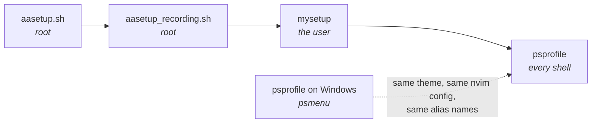

# aasetup · mysetup · psprofile

> One account, three tools, two operating systems. This is how they fit together
> and which of them owns what.

---

## At a glance

| Tool | Run by | Privilege | When | Owns |
|---|---|---|---|---|
| **`aasetup.sh`** / `aasetup_all.sh` | admin | **root** | once, at creation | the account: uid/gid, password, sudoers, first key |
| **`aasetup_recording.sh`** | admin | **root** | after creation | asciinema + atuin, locked offline by AppArmor |
| **`mysetup`** | the account holder | **none** (sudo only for packages) | any time, repeatedly | that account's own environment |
| **`psprofile`** | the account holder | none | every interactive shell | aliases, venv helpers, the prompt |

The split is deliberate: **root creates, the user configures.** `mysetup` refuses
to run as root, and `aasetup.sh` never asks the user a question.



---

## 1 · `aasetup` — making the account exist

Runs as root on Debian ≥ 12 or Ubuntu ≥ 24.04.

```bash
sudo bash aasetup.sh -u alice -e alice@example.com -n "Alice Example"

cp template-users.json users.json     # then edit it
sudo bash aasetup_all.sh              # every enabled user
```

Each account gets a uid/gid, optional passwordless sudo, a random 10-digit
password expired at first login, a generated git-identity keypair, and the
starting dotfiles. Credentials land in `/root/account-exports/<user>/` — hand
them over, then delete them.

`users.json` is **gitignored**; `template-users.json` is tracked. That is the
house rule for the whole repo: real names, keys and hosts stay out of git.

Existing accounts are skipped unless the roster says `on_exists: "setup"`.
Session recording is a separate step — see the README for the AppArmor lockdown
that keeps shell history and recordings on the machine.

---

## 2 · `mysetup` — configuring your own account

Plain Python 3 standard library. No venv, no pip, nothing to install.

```bash
./mysetup                    # interactive menu, loops until you quit
./mysetup --list             # tasks and whether each is already done
./mysetup --do gitconfig,vim # just these
./mysetup --all --dry-run    # every change a full run would make
```

The menu **loops**: setting an account up takes several passes, so after each one
you land back on the list with statuses recomputed — what you just ran now reads
`done`.

| | Task | Does |
|---|---|---|
| 1 | `sudoers` | renders the sudo rule, validates it with `visudo`, prints the install command for an admin |
| 2 | `tools` | system packages via sudo, **one `apt-get` per package** |
| 3 | `filetransfer` | trzsz and/or lrzsz — see [the Windows side](#4--the-windows-side) |
| 4 | `gitconfig` | `~/.gitconfig` from your identity |
| 5 | `nvim` | clones the house Neovim config (network) |
| 6 | `vim` | minimal `~/.vimrc` — no plugins, no network |
| 7 | `tmux` | `~/.tmux.conf` + plugin manager and plugins |
| 8 | `sshkey` | create, upload or paste this account's keypair |
| 9 | `sshconfig` | `~/.ssh/config` for the site's hosts |
| 10 | `authkeys` | paste public keys into `~/.ssh/authorized_keys` |
| 11 | `sshagent` | explains how to get an ssh agent running; changes nothing |
| 12 | `history` | preloads `~/.bash_history` so CTRL-r knows the house commands |
| 13 | `shell` | `~/.psprofile.sh` + Oh My Posh with `slimfat2` |
| 14 | `fonts` | Hack Nerd Font, for a terminal running *on* this machine |
| 15 | `theme` | one Catppuccin flavour across vim, tmux, bat and fzf |
| 16 | `chezmoi` | installs chezmoi; does **not** init a repo |

### Everything site-specific lives in `mysetup-etc/`

The script contains no names, addresses, repo URLs or package names — point it at
a different `mysetup-etc/` and it provisions a different site.

```
mysetup-etc/
  mysetup.conf      [vars] site values · [ask] questions · [task:*] the menu
  conf.d/*.conf     drop-in overrides, read after mysetup.conf
  packages.list     '7zip|p7zip-full' = first name that exists here
  files/            *.tmpl is rendered; anything else installed verbatim
  history/*.txt     command history, loaded in filename order
```

Task kinds: `files` `append` `packages` `repo` `sshkey` `authkeys` `sudoers`
`history` `command` `group`. A `when = <shell test>` makes a task apply only
where it makes sense (the trzsz PPA on Ubuntu, the `.rpm` on Fedora) and report
`n/a` elsewhere rather than failing.

### Five rules it never breaks

1. **Nothing changes before you see it.** Every task prints its description, then
   the exact commands, then asks. Declining reports `skipped`, not `ok`.
2. **An existing file is diffed first.** Differing dotfiles are shown as a
   coloured diff in `less -SRFX` before a prompt that defaults to yes; the
   original becomes `<name>.bak.<timestamp>`.
3. **One package per command.** A batch `apt-get` returns one exit code for
   twenty packages, so one unavailable name fails the other nineteen and the log
   never says which. Per-package, the failure names itself and the rest install —
   reported as `partial`.
4. **`--yes` means *accept the defaults*, not *approve everything*.** Prompts
   that default to no (writing into `/etc/sudoers.d`, replacing an SSH key) stay
   interactive.
5. **Secrets never sit next to what they unlock.** The `<key>.txt` record of how
   a key was made deliberately omits the passphrase.

### Keeping the cloned configs current

`nvim` and `tmux` clone repositories that keep moving — the house Neovim config
and TPM. Both entries are **update-aware**, so re-running one is how a new
release reaches the account:

```
[ INFO] fetching origin/main

      2 new commit(s) on origin/main:
        67137c4 v3: bump lazy-lock, new LSP servers
        59caf8e v2: add telescope keymaps

Fast-forward nvim to origin/main? [Y/n]
```

The menu shows `partial` when an update is waiting. That check is **offline** —
drawing a menu must not hit the network — so it reports against the last fetch,
and a pending update appears from the run after the one that fetched.

Two things it will not do, because the file in question is somebody's editor
config and being a version behind beats losing an afternoon's edit:

* **Uncommitted changes stop the update.** It names the files and prints the
  `git stash` / `merge --ff-only` pair to resolve it.
* **A diverged history is never rewritten.** It prints the `log --graph` to
  inspect and the `reset --hard @{u}` that would discard local commits, and
  leaves the choice to you.

`update = no | ask | yes` per task — `ask` is what both ship with; `yes` suits
an unattended run. The post-update step (`Lazy! sync`, `install_plugins`) now
runs only when something actually moved, so a no-op visit is quick; `--force`
runs it anyway, which is how you refresh *plugins* without a config change.

### Colour scheme (`theme`)

One question, four tools:

```
      Colour scheme (Catppuccin flavour)
        1) latte          2) frappe
        3) macchiato      4) mocha (current)
```

**Catppuccin** was chosen after checking it rather than by reputation: MIT
throughout, 19.7k★ on the main repo, and every port this stack needs pushed
within the last few months. Crucially all four pieces are *plain files* — no
plugin manager needed for vim or bat — so they are fetched from catppuccin's own
repositories at install time and `mysetup-etc` carries no vendored theme to go
stale.

| Tool | What lands | Where from |
|---|---|---|
| vim | `~/.vim/colors/catppuccin_<flavour>.vim` | `catppuccin/vim` |
| tmux | TPM plugin pinned at `v2.3.0` | `catppuccin/tmux` |
| bat | `.tmTheme` + `bat cache --build` | `catppuccin/bat` |
| fzf | catppuccin's own `FZF_DEFAULT_OPTS` snippet | `catppuccin/fzf` |

Each theme lives in **its own file** — `~/.vim/theme.vim`,
`~/.tmux.theme.conf`, `~/.config/mysetup/theme.d/*.sh` — which the main configs
source. So switching flavours never rewrites `~/.vimrc` or `~/.tmux.conf`, and
their diffs stay about vim and tmux settings rather than colours.
`mysetup --do theme-clear` deletes the fragments and everything falls back to
its default; the downloaded colorschemes stay, so switching back is instant.

**Two things it deliberately does not theme.** Neovim, because its colours
belong in the `mg-nvim-2025` repo it clones and mysetup should not write inside
someone else's git checkout. And the Oh My Posh prompt, because `slimfat2`'s
colours come from the psprofile repo and are shared with Windows — recolouring
it here would fork the one file that keeps both platforms identical.

For the terminal itself, `catppuccin/windows-terminal` supplies a settings
fragment — note that repo was last updated in **December 2023**, unlike the
rest, though a colour list needs little maintenance.

### The SSH key: three ways in

`sshkey` first shows all of `~/.ssh` — every file, its mode, what it actually is,
and who `authorized_keys` currently admits — then asks:

```
  1) create a new keypair here with ssh-keygen
  2) upload an existing keypair from your machine (trz)
  3) paste an existing keypair into vim
  q) skip this task
```

Whichever path runs, the files converge on the same treatment: **CRLF converted
to unix**, `0600` on the private half, and `ssh-keygen -y` to confirm the two
halves are the same key — pasting mismatched halves is otherwise only discovered
later as a refused login.

---

## 3 · `psprofile` — the shell layer

`~/.psprofile.sh` is the Linux counterpart of `profile.ps1` from
[mgua/psprofile](https://github.com/mgua/psprofile). **Same alias names**, so the
same muscle memory works on both sides.

| | |
|---|---|
| `se` `secd` `lv` | pick and activate a `~/venv_<project>`; `secd` also cd's to `~/<project>`; `lv` lists venv sizes |
| `fzcd` `fzl` `fzv` | fzf: cd to a folder, print a file, view a file |
| `gst` `gd` `gl` `gp` | `git status -sb`, diff, log graph, `pull --ff-only` |
| `sid` | switch identity: `~/.gitconfig_<id>` + `~/.ssh/config_<id>` (+ `id_rsa_<id>`) |
| `oo` / `omp` | toggle Oh My Posh on and off |
| `cm` `cmst` `cma` `cmdiff` | chezmoi, status, add, diff |
| `cdh` `ll` `la` `lla` | home, ls variants |
| `wup` | update everything — the apt/dnf answer to `winget upgrade --all` |
| `pspe` `pspr` `psmenu` | edit-and-reload, reload, list all of the above |

Run **`psmenu`** for the current list on either platform.

Aliases that exist only on Windows (`ex`, `npp`, `cyg`, `hed`) are listed at the
top of the Linux file with the reason they are absent, so the difference is
documented rather than discovered.

> **Everything past line ten is interactive-only.** A profile that writes to
> stdout in a non-interactive shell corrupts `scp` and `rsync` — a miserable
> fault to trace. A test asserts that sourcing it emits nothing.

### `oo` — the prompt toggle

`oo` swaps between the rich `slimfat2` prompt and a plain one. Both show the
active virtualenv, because losing it on toggle is worse than losing the colours:

```
on  →  slimfat2, with the venv in its python segment
off →  (venv_demo) claude@mgdebian:~/.ssh$
```

This is fiddlier than it looks. Oh My Posh installs its hook by making
`PROMPT_COMMAND` an **array** (bash ≥ 5.1), and assigning a scalar over an array
replaces only element 0 — leaving `_omp_hook` stranded and every later prompt
reporting `command not found`. The restore unsets the variable first, and the
saved "plain" snapshot filters the hook out so that re-sourcing via `pspr` or
`pspe` cannot capture it.

---

## 4 · The Windows side

The Linux box is the server; your Windows machine is the terminal. Several of
these features only work when **both** halves are installed, which is why they
are documented together.

### `psmenu` — the Windows installer

`psmenu` → **2 · Install Options** covers the whole Windows side:

| Key | Installs |
|---|---|
| `1` | `winget install Microsoft.Powershell` |
| `2` | **Nerd Fonts** — `Install-Module NerdFonts` then `Install-NerdFont -Name Hack` |
| `3` `4` | `git.git` · `JanDeDobbeleer.OhMyPosh` |
| `6` `7` `8` | `notepad++` · `vscode` · `neovim.neovim` |
| `T` | `choco install bat curl fd fzf mingw make` |
| `W` | `Microsoft.WindowsTerminal` |
| `9` | `winget upgrade --all` — the Windows twin of `wup` |
| `U` | upgrade psprofile itself via `git pull` |

`psmenu` → **3 · Editor options** points at each editor's config location,
including the Neovim one below.

Not in the menu but needed for the pieces below:

```powershell
winget install trzsz.tssh        # file transfer over ssh
winget install twpayne.chezmoi   # dotfiles, if you use it on Windows too
```

### Fonts

`slimfat2` is drawn almost entirely from **Nerd Font glyphs in the Unicode
Private Use Area** — powerline separators `U+E0B1`/`U+E0B3`, folder `U+E5FF`,
python `U+E235`, node `U+E718`, root bolt `U+F0E7`, clock `U+E641`, duration
`U+F252`, exit status `U+EA9F`.

So the font must be set **in the Windows Terminal profile**, not merely
installed. `psmenu` → 2 installs Hack Nerd Font, and
`winget install DEVCOM.JetBrainsMonoNerdFont` is an alternative. Either way,
set it as the profile's font face afterwards.

**On the Linux box itself**, `mysetup --do fonts` installs the same Hack Nerd
Font — but only where there is a graphical environment to use it from, since
over ssh the font that matters is the one in *your* terminal. With sudo it goes
to `/usr/share/fonts/truetype/hacknerd` for every account; without, to
`~/.local/share/fonts`. Select **Hack Nerd Font Mono** in the terminal profile
for strict monospace alignment.

> **A Private Use Area caveat that looks like a bug.** Those codepoints render
> correctly in a terminal with the font and as `▓` or blanks *everywhere else* —
> a browser, a chat window, a bug report. Prompt output that looks broken when
> pasted elsewhere is usually intact where it was produced.

### Editors

The **same Neovim config runs on both sides** —
[`mgua/mg-nvim-2025`](https://github.com/mgua/mg-nvim-2025):

| | Path | Installed by |
|---|---|---|
| Linux | `~/.config/nvim` | `mysetup --do nvim` |
| Windows | `~/AppData/Local/nvim` | `git clone` (`psmenu` → 3 → 3) |

`vi`, `vim`, `nv` and `nvim` all reach Neovim on both platforms — on Linux only
when Neovim is actually present, so `vim` is never aliased to something missing.
`~/.vimrc` stays useful for plain `vim` on a box where you skipped the Neovim
clone.

### File transfer — `trz`/`tsz` and the old `rz`/`sz`

**The ssh client decides, not the terminal emulator.** This is the thing that
misleads everyone, including an earlier draft of this guide: ZMODEM does *not*
have to live in the terminal. `trzsz` implements both protocols itself, so with
`tssh` as your client both the new and the old commands work in plain Windows
Terminal.

```powershell
winget install trzsz.tssh     # the client that speaks both protocols
winget install trzsz.lrzsz    # client-side rz/sz binaries, for the ZMODEM path
```

| Your client | `trz` / `tsz` | `rz` / `sz` |
|---|---|---|
| `tssh host` | ✅ | — |
| `tssh --zmodem host` | ✅ | ✅ |
| bare `ssh.exe` in Windows Terminal | ❌ | ❌ |
| SecureCRT, ZOC (native ZMODEM) | ❌ | ✅ |

`rz` and `sz` are the *lrzsz* commands, and they are decades old — which is the
point. They are on every Unix that has ever existed, the muscle memory is
already there, and trzsz has made them work again on Windows without a
special-purpose terminal. Upstream is explicit that `trzsz --zmodem ssh` is
**not** supported on Windows and `tssh --zmodem` is the way there.

On the Linux side, `mysetup --do filetransfer` installs the server half —
choosing the trzsz PPA on Ubuntu, the `.deb` on Debian and the `.rpm` on
Fedora/RHEL automatically, and offering `lrzsz` alongside, since every distro
packages that one. When neither `trz` nor `rz` is present, `sshkey`'s upload
option is greyed out rather than offered.

> Both protocols move **files**. OSC-52 moves the **clipboard**. They are
> unrelated, and neither depends on the other.

### Identity

`sid` on both platforms switches `~/.gitconfig_<id>` and `~/.ssh/config_<id>`
into place, backing up what was there, and swaps `id_rsa_<id>` → `id_rsa`.

> ⚠️ `sid` and `mysetup --do gitconfig` / `sshconfig` write the *same two files*.
> Running mysetup after `sid` reverts the identity. The diff prompt shows it
> before it happens, but nothing prevents it yet.

---

## 5 · The clipboard chain

This is the most failure-prone thing in the whole setup, because a copy crosses
**five programs** and any one of them can swallow it without saying so. Nothing
errors. The clipboard simply does not change.

Two facts make the rest make sense:

1. **Copy is a protocol; paste is just typing.** Copying out uses an escape
   sequence (OSC-52) that the remote program emits and the terminal obeys.
   Pasting in is your terminal replaying the clipboard as keystrokes. They share
   no machinery.
2. **The asymmetry is deliberate.** Terminals implement the OSC-52 *write* and
   refuse the *read*, because a read would let any host you ssh into silently
   exfiltrate your clipboard. So: **copy out, type in.**

### Why not `xclip`?

`xclip` is in `packages.list` and is the wrong tool for a server.

| | |
|---|---|
| `xclip`, `xsel` | need an **X display**. On a headless box there is none, and `"+y` fails or hangs. |
| X11 forwarding | works, but needs an X server on Windows and forwards far more than a clipboard. |
| **OSC-52** | just bytes on the tty. Survives ssh, tmux, `su`, nested shells. Nothing to forward, no port, no daemon. |

On this box Debian's `vim` is built **without** clipboard support at all —
`vim --version` reports `-clipboard -xterm_clipboard`. There is no `"+`
register to yank into. That is not a misconfiguration to fix; it is why the
shipped `~/.vimrc` implements OSC-52 by hand.

### The chain, copy direction

```
vim / nvim  →  tmux  →  ssh  →  Windows Terminal  →  Windows clipboard
   emits       forwards   carries     obeys              receives
  OSC-52       OSC-52     bytes       OSC-52
```

| Link | Must | Fails silently when |
|---|---|---|
| editor | emit `ESC]52;c;<base64>BEL` | vim has no `+` register; nvim found no provider |
| tmux | forward the sequence outward | `set-clipboard` is `off`; the outer `TERM` has no `Ms` |
| ssh | nothing at all | — |
| Windows Terminal | honour OSC-52 writes | payload too large; OSC-52 disabled |

### Link 1 — the editor

**Neovim** (0.12.4 here) ships an OSC-52 provider and, in the TUI, *queries the
terminal* to see whether it is supported. If the query succeeds and no other
clipboard tool was found, `"+y` works with no configuration.

The catch is in Neovim's own documentation:

> Using a terminal multiplexer (e.g. tmux) may inhibit automatic OSC 52 support
> detection.

Which is exactly the case here, because everything runs in tmux. So force it
rather than hoping the probe lands — in your `init.lua`, before anything calls
`has('clipboard')`:

```lua
vim.g.clipboard = 'osc52'
```

Auto-detection can be turned off entirely with `vim.g.termfeatures.osc52 = false`.

**Vim** has no clipboard support in Debian's build, so `~/.vimrc` does the job
directly: `SPACE-y` in visual mode base64s the register and writes the sequence
to the terminal, then reports `N lines yanked → OSC52 clipboard`. That message
is the confirmation that link 1 fired — if you do not see it, nothing further
down was ever given anything to carry.

### Link 2 — tmux

Three settings, all in the shipped `~/.tmux.conf`:

```tmux
set -g set-clipboard on                        # not the default 'external'
set -g default-terminal "tmux-256color"
set -ga terminal-features ",xterm*:clipboard"
```

- **`set-clipboard on`** — an application's OSC-52 write both lands in a tmux
  buffer *and* is forwarded outward. The default, `external`, forwards but does
  not fill the tmux buffer.
- **`default-terminal`** — tmux consults the `Ms` terminfo capability to decide
  whether it may forward OSC-52. `tmux-256color` carries
  `Ms=\E]52;%p1%s;%p2%s\007`; **`screen-256color` carries an empty `Ms`**, and
  with it tmux drops every clipboard write in silence. tmux ≥ 3.2 already
  defaults to `tmux-256color`, but older tmux did not, so it is pinned.
- **`terminal-features`** — asserts that the *outer* terminal accepts OSC-52,
  for emulators whose `TERM` does not advertise `Ms`.

The `tmux-yank` plugin covers the other direction into tmux: selections made in
copy-mode, rather than inside an editor.

### Link 3 — ssh

Nothing to configure, and nothing that can go wrong. OSC-52 is bytes in the
terminal stream; ssh neither knows nor cares. This is the whole reason the
approach works where `xclip` cannot.

### Link 4 — Windows Terminal

Honours OSC-52 writes, so the sequence becomes a real clipboard change. The one
practical limit is size: a very large yank can exceed what the emulator accepts
and be dropped. If a 3-line yank works and a 10,000-line one does not, that is
this link, and the answer is `tsz` — send the file instead of copying its text.

### Paste — the other direction

`Ctrl+Shift+V` or right-click. The terminal sends your clipboard as input, so
the remote side sees typing.

Modern vim and nvim advertise **bracketed paste**, and the terminal wraps the
payload in `ESC[200~ … ESC[201~` so the editor knows it is a paste and not
someone typing very fast. Without it, `autoindent` — which the shipped `.vimrc`
sets — compounds on every line and turns pasted code into a staircase. If you
ever see that, you have lost bracketed paste:

```vim
:set paste      " paste, then
:set nopaste
```

### Why you cannot paste *from* the remote host

There is an OSC-52 read form, and terminals decline it on purpose. A remote host
that could read your clipboard could read whatever you last copied — a password,
a token — without asking. So `"+p` inside nvim over ssh has nothing to fetch.
Use terminal paste. This is a security property, not a gap to work around.

### Diagnosing it, one layer at a time

When the clipboard stops working, do not adjust the editor first. Test the chain
from the outside in — each step adds exactly one link.

**1 · Terminal and ssh alone.** No tmux, no editor:

```bash
printf '\033]52;c;%s\007' "$(printf 'osc52-step-1' | base64 -w0)"
```

Then paste into Notepad. If this fails, nothing above it can work — the problem
is Windows Terminal or the ssh session, and no editor setting will help.

**2 · Add tmux.** The same command, inside a tmux pane. If step 1 worked and this
does not, it is tmux: check `tmux show -g set-clipboard` (want `on`) and
`echo $TERM` inside the pane (want `tmux-256color`, **not** `screen-256color`).

**3 · Add Neovim.** `:lua vim.fn.setreg('+', 'osc52-step-3')`. If it reports
`No provider`, the terminal probe failed — set `vim.g.clipboard = 'osc52'`.

**4 · Add Vim.** Visual-select a line, `SPACE-y`, and look for the
`→ OSC52 clipboard` message.

| Symptom | Almost always |
|---|---|
| step 1 fails | Windows Terminal, or OSC-52 turned off in it |
| step 1 works, step 2 does not | `set-clipboard`, or `TERM=screen-256color` inside tmux |
| nvim says `No provider` | probe inhibited by tmux — force `vim.g.clipboard = 'osc52'` |
| vim `"+y` does nothing | Debian vim is `-clipboard`; use `SPACE-y` |
| small yanks work, large ones do not | emulator size limit — use `tsz` instead |
| pasted code is a staircase | bracketed paste lost — `:set paste` |
| paste *from* remote does nothing | by design; terminals refuse OSC-52 reads |

---

## 6 · What matches on both sides

| | Linux | Windows |
|---|---|---|
| Prompt | Oh My Posh + `slimfat2` | Oh My Posh + `slimfat2` |
| Theme source | fetched from the psprofile repo | the psprofile repo |
| Neovim config | `mgua/mg-nvim-2025` | `mgua/mg-nvim-2025` |
| Venv layout | `~/venv_<project>` → `~/<project>` | same |
| Update all | `wup` | `psmenu` → 9 |
| Search tools | `bat` `fd` `fzf` (apt) | same (choco, `psmenu` → T) |
| Dotfiles | chezmoi | chezmoi |
| Reload profile | `pspr` / `pspe` | `pspe` |

---

## 7 · Where to change what

| Change | Edit |
|---|---|
| A site value — domain, git host, key type | `mysetup-etc/mysetup.conf` → `[vars]` |
| A question mysetup asks | `[ask]` (cached in `~/.config/mysetup/answers.conf`) |
| A dotfile's contents | `mysetup-etc/files/` — never `~` directly |
| A menu entry, or its order | `[task:*]` and `[menu] order` |
| The system package list | `mysetup-etc/packages.list` |
| Preloaded shell history | `mysetup-etc/history/*.txt` |
| A shell alias | `mysetup-etc/files/psprofile.sh`, then `mysetup --do psprofile` |
| The prompt | `slimfat2.omp.json` in the psprofile repo — both platforms follow |
| Host-specific overrides | `mysetup-etc/conf.d/*.conf`, or a gitignored `mysetup-etc.local/` |

Editing a file in `~` directly works until the next `mysetup` run offers to
replace it. The diff prompt will show you exactly that — but the source of truth
is `mysetup-etc/`.
