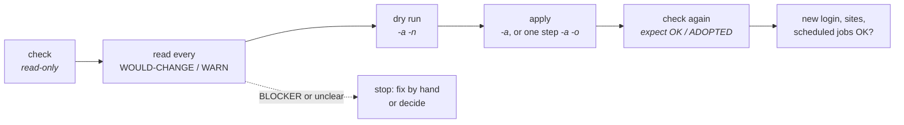

# vf-harden · operator guide

> How to harden a server with `aasetup_harden.sh` **without locking yourself out
> or breaking what runs on it**: what to prepare, the normal workflow, how to read
> the results, and how to get back if something goes wrong.
>
> [`README.md`](README.md) is the reference (every step, flag, file and exit code).
> This guide is the *how*. Read it once before the first real run.

---

## At a glance

| You want to… | Run (as root) | Changes anything? |
|---|---|---|
| see where a server stands | `aasetup_harden.sh -l green` (then `-l yellow`, `-l red`) | **no** |
| see exactly what would be done | `… -l yellow -a -n` | **no** |
| prove a hardened server needs nothing | `… -l yellow -a -x` | **no** (stops before the first change) |
| apply one level | `… -l green -a` | yes, recorded for rollback |
| apply one step | `… -l yellow -a -o G9` | yes, only that step |
| apply one red step | `… -l red -a -R -o R3` | yes, only that step (red needs `-R` + `-o`) |
| undo the last run | `… -l yellow -r latest` | yes, only what the tool itself did |

**The five rules**

1. **Check first, always.** A check is read-only: it never writes a file, a log line or a state folder.
2. **One level at a time, one risky step at a time.** Green, then yellow, then red, never mixed.
3. **For yellow and red: console open, snapshot taken, a second SSH session ready.**
4. **Never close your working session after an access step** (G1, G2, G3, G4) until a *new* login works.
5. **Read every `WOULD-CHANGE`, `WARN` and `BLOCKER` before applying.** They are the tool telling you what it found. Decide, don't skip.

---

## 1 · What it is (and is not)

It checks a server against the **VF G-0312** standard step by step, applies only
what is missing, verifies each change, and records everything so it can be undone.
It works on a **fresh** server and on one **already in production**: settings that are
already in place, in whatever file, are recognised as `ADOPTED` and left alone.

It is **not** a one-shot "harden everything" script. Every change is a decision, and
the tool is built to make those decisions visible.

| Level | What it changes | When to run it | Risk |
|---|---|---|---|
| **green** | permissions, banners, logging, settings that don't change behaviour, reports | office hours | low |
| **yellow** | what users and apps can do: SSH, sudo, su, PAM, umask, network settings, services, mount options, password policy | maintenance window, console open | **can lock people out** |
| **red** | password ageing of existing accounts, auditd, GRUB password, `/tmp`, package removal | its own window, one step at a time | **can stop the server or need a reboot** |

---

## 2 · Before you start

**Every time**

- [ ] You are on the **right server** (`hostname -f`, its IP). Several servers look alike.
- [ ] You have **root through sudo** from your own account.
- [ ] The right **profile** will be used. `auto` picks `plesk` when `/usr/local/psa` exists; check the first lines of the output.
- [ ] The **site file** `vf-harden/profiles.local/<profile>.conf` is in place on the server: root-owned, not writable by others. It holds the real addresses and account names. It is not in git, so copy it yourself.

**Additionally for yellow and red**

- [ ] **Console access works without the network** (vSphere/VMware console, a password you have *tested*). If SSH or PAM breaks, this is your only way in.
- [ ] **A snapshot** of the VM, without memory, with a name that says what comes next (`<host>-harden-yellow-before`).
- [ ] **A second SSH session**, already logged in and `sudo -i`, kept open until the end.
- [ ] **A quiet time** and the people who run the applications reachable.
- [ ] For red: **know whether a reboot is acceptable** today, and who does it.

---

## 3 · The normal workflow



```bash
cd /path/to/aasetup
sudo bash aasetup_harden.sh -l green                 # 1. where do we stand?
sudo bash aasetup_harden.sh -l green -a -n           # 2. what exactly would be done?
sudo bash aasetup_harden.sh -l green -a              # 3. do it (each step verified)
sudo bash aasetup_harden.sh -l green                 # 4. now everything OK / ADOPTED?
```

Then the same for yellow (in the window, console open). For red, one step per run
(see §5). After each level, check what the server is *for*: a few real sites
answer, a scheduled job ran, an admin can still log in and sudo.

**Already-hardened server, or a server you didn't set up?** Run the check, then
`-a -x`. If nothing would change, `-x` ends with exit 0 and has proven it. If
anything would change, it stops **before** the first change (exit 1) and you read
what it would do.

---

## 4 · Reading the output

Every step ends with one status, and the summary lists them all:

| Status | Means | What you do |
|---|---|---|
| `OK` | compliant, applied by this tool earlier | nothing |
| `ADOPTED` | compliant through somebody else's work (another file, a template, a hand fix) | nothing. The tool will never touch it. |
| `…+WARN` | compliant, with a remark | read the remark; usually a decision for a person, not a fix |
| `N/A` | doesn't apply here (e.g. no NTP servers configured) | nothing, or fill in the profile |
| `EXCEPTION` | the profile deliberately excludes it | nothing; it's documented in the profile |
| `WOULD-CHANGE` | not compliant; the `fix` lines say exactly what apply would do | read the lines, then dry-run and apply, or decide not to |
| `HELD` | a risky step that only runs when asked explicitly (G3) | see §5 |
| `BLOCKER` | a precondition failed (e.g. a file with our name that we didn't write, a wrong value it won't overwrite) | **stop.** Fix by hand or decide; apply won't touch it |
| `APPLIED` | changed in this run and verified | check the server |
| `FAILED` | the change or its verification failed; **that step was undone automatically** and the run stopped | read the log in the run folder (§7) |

Item lines: `ok`, `n/a`, `fix` (would be changed), `warn`, `BLOCK`. Add `-v` to also see the `ok` lines.

**Exit codes**, for scripts: `0` fine, `1` something would change / stopped by `-x` / held,
`2` a step failed and was undone, `3` blocker, `4` rollback partial, `5` usage or environment.

---

## 5 · The levels in practice

### Green

Run it in office hours. Nothing in it changes how people or applications work. The
AIDE baseline (`-b`) reads the whole disk at idle priority: start it off-hours.

**Refreshing AIDE by hand?** Accept changes only after checking them (`dpkg --verify` on the updated
packages). Then make sure the database belongs to the user the nightly check runs as
(`systemctl show dailyaidecheck.service -p User`), e.g. `chown _aide:_aide /var/lib/aide/aide.db*`.
Otherwise the nightly check fails silently and still reports "no changes". V8 checks this.

### Yellow

Run it in a window, console open, snapshot taken. The tool orders the steps
itself: the ones that don't touch access first, then sudo (G2), SSH (G1), su (G4),
and **PAM lockout (G3) last**.

- **After G1 (SSH):** open a **new** SSH session and log in before doing anything else.
  The tool runs `sshd -t` before reloading and checks the cases listed in `SSH_VERIFY_CASES`.
- **After G2 (sudo):** in the new session, `sudo -k; sudo true`.
- **G3 (PAM: lockout after failed passwords, password history)** is the riskiest step.
  It is `HELD` unless you run it **alone** (`-a -o G3`) or confirm the console is open
  (`-C`). Run it alone, with the console logged in. Then from a new session:
  log in, `sudo true`, and fail a test account's password a few times to see the lockout count.
  The tool prints its own rollback commands right after; keep them.
- **G5 (umask 027, idle logout):** files you create by hand as root are no longer
  readable by others. On a web server, fix the permissions of files you put into a
  site by hand.
- If your password policy changes (V6), test that a **normal user can change their
  own password** (`passwd`). A missing password dictionary breaks exactly that.

### Red

Red steps can stop the server, need a reboot, or can't be cleanly undone. A red
apply needs **`-R`** ("I accept red risks") **and `-o` naming the step(s)**, e.g.
`aasetup_harden.sh -l red -a -R -o R3`. Without both, it stops before touching anything.
Step IDs: R6 reports, R2 system accounts, R1 password ageing, R7 removing old client
packages, R5 `/tmp`, R3 auditd, R4 GRUB.

- **Never reboots by itself.** When a step needs one (R4 GRUB, R5 `/tmp`, R3 once the
  audit rules are locked), the summary ends with **REBOOT REQUIRED**. Reboot when *you*
  decide, with the console open. If a reboot timer is already scheduled, R4 refuses to run.
- **GRUB password (R4):** the password must already be in the team's password manager
  *before* you apply. Create its hash with `grub-mkpasswd-pbkdf2` and give the tool only
  the hash: a root-only file (mode 0600) or `VF_GRUB_PASSWORD_HASH` in root's environment,
  never on the command line. Before rebooting, it checks that the server can still
  start unattended (`--unrestricted`).
- **Password ageing for existing accounts (R1):** people only. Service and
  application accounts (e.g. Plesk site users) and break-glass accounts
  (`EXPIRY_EXEMPT`) are never aged. Tell people their date.
- **auditd:** the server must never stop because the audit log fills the disk.
  Locking the rules (`-e 2`) is a separate, later decision: only with `-E -o R3`, and only
  after the observation days in the profile (`AUDIT_OBSERVE_DAYS`). Once locked, any rule change needs a reboot.
- **Package removal (R7):** the tool simulates first and refuses if anything beyond the
  listed packages would go.
- **Reports (R6, and V10 in green):** read-only, but they scan the whole disk; on a big
  server run them on their own (`-o R6`) or skip them (`-s R6`).

---

## 6 · Profiles: where the settings come from

```
profiles/default.conf           the standard's values, every setting (in git)
profiles/<type>.conf            overrides for a server type, e.g. plesk.conf (in git)
profiles.local/default.conf     your site's values for every server (NOT in git)
profiles.local/<type>.conf      your site's values for that type (NOT in git)
```

Loaded in that order; **later files win**. `-p auto` (the default) picks `plesk`
when Plesk is installed; force one with `-p default` or `-p plesk`.

- **Change the standard for one kind of server** → its `profiles/<type>.conf`, with a comment saying *why* (what broke).
- **Your addresses, account names, relay hosts** → `profiles.local/`. Never commit them: this repo may be public.
- **A new kind of server** (e.g. a Kubernetes node) → a new `profiles/<type>.conf`, then `-p <type>`.
- **No secrets in any profile.** Passwords and hashes go to the password manager (and, for GRUB, a root-only file).
- The profile files are run as root by the tool: keep them root-owned and not writable by others, or it refuses to start.

---

## 7 · Undoing a run

Every apply run leaves a record in the state folder (default `/var/lib/vf-harden`):

```bash
sudo ls /var/lib/vf-harden/runs/                         # one folder per apply run
sudo cat /var/lib/vf-harden/latest/manifest.tsv          # every change, written before it was made
sudo bash aasetup_harden.sh -l yellow -r latest          # undo the last run (asks first)
sudo bash aasetup_harden.sh -l yellow -o G3 -r latest    # undo only G3 of that run
```

Rollback **only undoes what that run's manifest says the tool did**, and only if
the file or setting is still exactly as the tool left it. Anything changed since
is kept and listed, and the rollback ends `PARTIAL` (exit 4). Then compare the backup in
`runs/<id>/files/` by hand.

**Keep the state folder.** Without it the tool can't undo anything. Snapshots and
the backups of the files it changed are your other two safety nets.

---

## 8 · If something goes wrong

| Symptom | First move |
|---|---|
| A new SSH login is refused after G1 | Use the **open second session**: `sudo bash aasetup_harden.sh -l yellow -o G1 -r latest`. No session left: console, then the same. |
| `sudo` fails after G2 | Console as root: `-o G2 -r latest`, or `visudo -c` and remove the newest file in `/etc/sudoers.d/`. |
| Locked out after G3 (too many failed passwords) | Wait the unlock time, or as root: `faillock --user <name> --reset`. Broken PAM: the console fallback the tool printed (`cp -a <run>/files/etc/pam.d/common-* /etc/pam.d/`). |
| `su` refused for an admin after G4 | Add them to `sugroup` (`gpasswd -a <name> sugroup`), or use `sudo -i`. |
| A site or application misbehaves after yellow | Roll back the last run, then re-apply step by step (`-o`) to find the one. |
| A scheduled job stopped running | `journalctl -u cron`; check the cron folders' permissions and `cron.allow` (V3). |
| The server waits at the boot menu after a red reboot | Console: the GRUB password from the password manager, boot the normal entry; then fix `--unrestricted`. |
| The new kernel doesn't boot | Console: GRUB menu → *Advanced options* → the previous kernel. |
| Anything worse | **Revert the snapshot.** That's what it's for. |

Recovery without any password: force the VM into its BIOS/EFI setup, exit to the
GRUB menu (tap `Esc`), edit the boot entry, append `init=/bin/bash`, then
`mount -o remount,rw /` and fix. **Note:** a GRUB password (red) blocks exactly this.
That's why its password must be stored before it's set.

---

## 9 · What the tool promises

- A **check never writes** anything.
- It **never edits or deletes a file it didn't create**. The exceptions are files whose
  content *is* the setting (e.g. `/etc/issue`); those are backed up first.
- It **records every change before making it**, and undoes a step at once if that
  step's verification fails.
- After every applied step it checks that **nothing else broke**: no new failed
  services, `sshd -t`, `visudo -c`, and that the admin running it still has sudo.
- It **never reboots**, never purges a package without a simulation, and never
  touches customer files on a hosting server.

What it can't promise: that a setting won't break an application it has never seen.
That's what the dry run, the order of the steps, one-step-at-a-time and the
snapshot are for.
